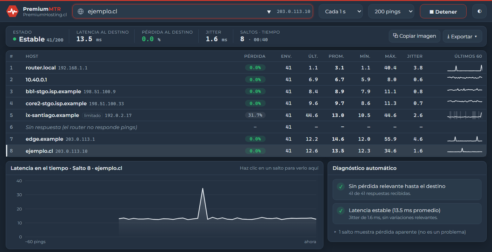

  

<h1 align="center">PremiumMTR</h1>

  <b>Traceroute y ping continuo para Windows, moderno y en español.</b> 
  Una alternativa a WinMTR que, además de medir la ruta, explica lo que ve.

  
  
  

  

## ⬇️ Descargar

Entra a la **[última versión](../../releases/latest)** y elige:

| Archivo | Para qué |
|---|---|
| `PremiumMTR_x.y.z_x64-setup.exe` | **Instalador** (recomendado). No pide permisos de administrador. |
| `PremiumMTR_x.y.z_portable.exe` | Versión **portable**: se abre con doble clic, sin instalar. |
| `SHA256SUMS.txt` | Huellas para verificar que los archivos no fueron alterados. |

**Requisitos:** Windows 10 u 11 de 64 bits.

> [!NOTE]
> Esta versión todavía no está firmada digitalmente, así que Windows puede mostrar *"Windows protegió su PC"*. Para abrirla, haz clic en **Más información → Ejecutar de todas formas**.

## Qué hace

- **Ruta completa en vivo**: pérdida, latencia (último, promedio, mínimo y máximo) y **jitter** de cada salto, con un mini gráfico de los últimos 60 pings.
- **Diagnóstico automático** en lenguaje simple. Distingue la **pérdida real** de la **pérdida aparente** de los routers que limitan los pings, la causa más común de falsas alarmas en WinMTR.
- **Se detiene sola** a los 200 pings (configurable), para no dejarla midiendo indefinidamente.
- **Reportes para soporte**: copiar una **imagen** del resultado para pegarla en un correo, ticket o WhatsApp, o guardar un reporte HTML, PNG o de texto en formato WinMTR.
- **Liviana y sin permisos de administrador**, con tema claro y oscuro.

## Cómo leer los resultados

| Lo que ves | Qué significa |
|---|---|
| Pérdida en **gris**, con la etiqueta `limitado` | El router responde solo algunos pings para protegerse. **No afecta tu conexión.** |
| Pérdida en **amarillo o rojo** que sigue hasta el destino | **Pérdida real.** El diagnóstico indica en qué salto empieza. |
| "Sin respuesta" en un salto | El router no responde pings. Es normal. |
| Jitter sobre 30 ms | La latencia varía mucho; puede afectar llamadas y videollamadas. |

## Privacidad

Las mediciones se hacen desde tu equipo y no se envían a ningún servidor. La app no tiene telemetría.

## Soporte

¿Encontraste un problema o tienes una sugerencia? Abre un [issue](../../issues).

---

Desarrollada por José Antonio Dieguez con asistencia de Claude Opus 5.5 (Anthropic) · Herramienta provista por <a href="https://premiumhosting.cl">PremiumHosting.cl</a> © 2026 José Antonio Dieguez. Todos los derechos reservados. Tipografía Montserrat bajo licencia SIL Open Font License 1.1.

